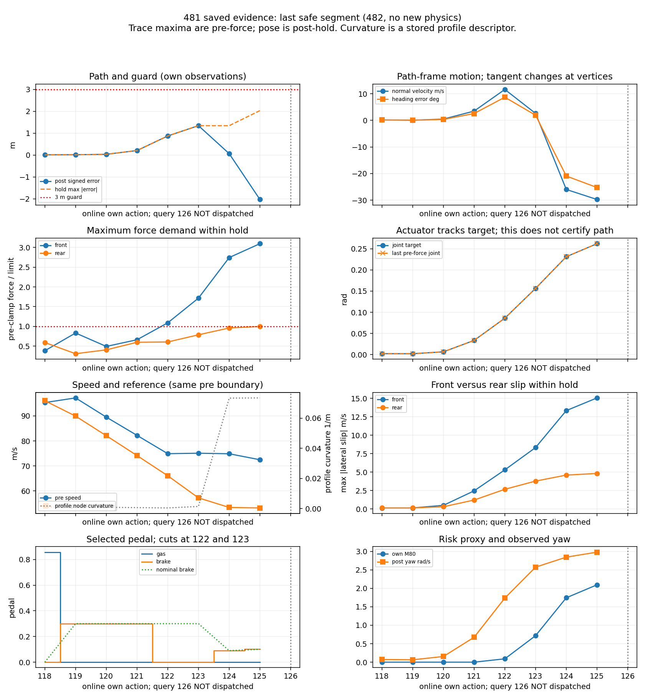

# 482 — 저장 자료 분석: M80와 경로 여유의 충돌, 원인 확정은 보류

**새 물리 적분·world·native·reset은 모두0이다.** 481의 기준선은 **안전 prefix73회 후74번째 unsafe**, 온라인은 **125회 안전 후 query126 후보 소진**이다. 두 모델 모두 미완주이며 안전 행동 수나479의 단일 hold 효과를 완주 개선으로 읽지 않는다. 이번 결과는 저장된 cold 예측과 실제로 실행된 모델 own 이력의 분석이다.

유효한 미선택 후보가 더 큰 경로 여유를 갖는 사례가 앞서 반복 관측됐다. 따라서 다음 **단일 가설은 기존 후보·조향·80ms·guard를 유지한 margin-first 순위 변경**이다. 최종 실패의 원인을 입증했다는 뜻은 아니다. [제안 계약](diagnostic482_contract.json)은 실행하지 않았다.

## 징후의 시점과 관측 경계

아래 속도/기준속도는 **동일 pre 경계**, 오차/heading/법선속도는 **own hold 종료**, wheel 값은 **hold 내부 pre-force 최대치**다. heading은 차체 전방과 최근접 경로 접선의 각도, 법선은 경로의 왼쪽을 양으로 정했다. profile curvature는 pre 투영 segment의 저장값이며 polyline 위의 미분 곡률이나 관측 yaw와 동일하지 않다.

| own 행동 | pre 속도/기준 m/s | 종료 signed 오차 m | 종료 법선속도 m/s | heading ° | yaw rad/s | 앞/뒤 최대 횡슬립 m/s | 앞/뒤 force ratio |
|---|---:|---:|---:|---:|---:|---:|---:|
| 120 | 89.52/82.10 | +0.033 | +0.48 | +0.35 | 0.153 | 0.50/0.31 | 0.494/0.407 |
| 121 | 82.22/74.17 | +0.207 | +3.49 | +2.58 | 0.675 | 2.47/1.23 | 0.663/0.599 |
| 122 | 74.91/66.09 | +0.873 | +11.63 | +8.71 | 1.736 | 5.32/2.68 | 1.091/0.607 |
| 123 | 75.10/57.26 | +1.344 | +2.63 | +1.94 | 2.574 | 8.34/3.80 | 1.717/0.788 |
| 124 | 74.88/53.44 | +0.065 | −25.99 | −20.94 | 2.845 | 13.35/4.61 | 2.744/0.961 |
| 125 | 72.49/53.24 | −2.032 | −29.76 | −25.25 | 2.980 | 15.08/4.83 | 3.095/0.999 |

119부터 pre 속도가 하강하는 P4 기준을 약7m/s 초과한다. 119~121에는 brake0.3이 유지됐다. **121의 횡운동 증가,122의 앞바퀴 clipping,124의 큰 음의 법선속도/heading**이 마지막 위험 축적의 관측 근거다. 122~123에서는 brake가0으로 선택돼 pre 속도가 약75m/s에 머무는 동안 기준속도는66.09→57.26m/s로 내려갔다. 동일 상태에서 brake를 유지한 저장 예측은 각각 약67.52/67.62m/s로 끝났다. 그 명령을 이후 계속 실행한 궤적은 관측하지 않았다.

124의 종료 오차0.065m는 회복 인증이 아니다. hold 전체 guard 최대 오차는 여전히1.344m이고, 이미 −25.99m/s의 법선속도가 남아 있었다. 125의 hold guard 여유는0.968m까지 줄었다. 118~125의 pre-force 투영은 모두 interior이며 projected arc가 매 raw1.148~1.944m씩 증가했다. 연속한 segment의 접선이 바뀌면서 heading/법선 성분도 바뀌므로 부호 변화를 매끈한 Frenet 미분으로 해석하지 않는다. 이 구간에서 투영 tie·역방향 branch jump는 없었고 실제 own의 road contact는 모두4, grass는0이었다.

전 구간의 최초1m 오차 초과는 행동3이며 후속에 회복했다. 단순 임계값을 소급해 예측 경보 성능으로 주장하지 않는다. 최종 구간의 앞 force ratio>2, |법선속도|>5m/s, |heading|>10°의 연속 시작은124다. 다른 시점의 일시 초과도 [집계](diagnostic482_summary.json)에 포함했다.

## 조향 목표·servo와 앞뒤 힘

[원래 조향](pace269_run.py:22)은 속도에 따른 preview 거리 `clip(3.24+0.22v,6,25)`와 목표점의 body-right 오프셋을 쓰는 pursuit다. 직접적인 heading/yaw/profile-curvature 피드백 항은 없다. `.8현재+.2이전` 명령 평활화는 servo 지연과 구분해야 한다. 122~124에서 평활화로 생긴 조향 차이는 약0.0131/0.0176/0.0187rad다. 저장 profile curvature는 pre122의0.000480에서 pre124의0.073250m⁻¹로 커진다. 이는 급격한 경로 방향 변화와 속도 기준 하강의 진단 자료이며 정밀 타이어 한계 계산은 아니다.

[물리 조향 목표](source_vehicle_transition.py:217)는 `−action.steer`다. 122~125의 앞 joint 목표는0.08605→0.15644→0.23119→0.26201rad이며 각 hold 마지막 pre-force joint는 이에 약0.4~3.7μrad 오차로 도달했다. 전체125행에서도 마지막 pre-force 최대 오차는0.0000334rad다. 첫 raw 샘플은 새 목표가 들어온 직후이므로 그 오차를 servo 고장으로 읽지 않는다. [servo 요청 속도 제한](../core/vendor/car_dynamics.py:153)은 실제 관절속도 보장이 아니며, 평활화·preview 법칙 자체가 적절했다는 인증도 아니다.

122~125의 앞 최대 lateral force 요구는436→684→1,095→1,236N, 뒤는220→311→378→396N이다. 도로 friction limit400N에 비해 **앞 lateral 요구가 지배적으로 포화**됐다. 125의 앞 최대 longitudinal 요구는95N에 불과하지만 값들은 서로 다른 wheel/raw의 최대일 수 있어 벡터 합으로 더하지 않는다. longitudinal slip·raw force·앞뒤 clipping과 상세 시계열은 [추가 집계](diagnostic482_findings.json) 및 비공개 전체 파생 자료에 보존했다. 잘 따라간 joint와 앞 횡력 포화는 공존한다.

## 12회 pedal 감소와 목적함수 충돌

모든12회에서 nominal도 기존 guard상 유효했다. Δ는 **같은 context에서 선택한 cold 예측−nominal cold 예측**이며, 오차는 종료점만이 아닌 기존 raw guard 최대값이다. 양의 Δ오차가 안전 여유 소비다. 미선택 예측은 각 한 번이므로 미선택 warm 반사실이나 반복 재현성으로 확대하지 않는다.

| 행동 | branch | nominal→선택 pedal | ΔM80 | Δguard 최대오차 m |
|---|---|---:|---:|---:|
| 3 | brake | .300→0 | −.071810 | +.107498 |
| 4 | brake | .300→.050831 | −.055336 | +.013101 |
| 5 | brake | .053602→약0 | −.017320 | 0 |
| 41 | gas | .726635→0 | −.045338 | 0 |
| 42 | gas | .723050→0 | −.007982 | 0 |
| 62 | brake | .291710→0 | −.115822 | +.008660 |
| 63 | gas | .198812→0 | −.004922 | +.00000043 |
| 64 | gas | .596162→0 | −.005681 | 0 |
| 65 | gas | .885134→0 | −.015938 | −.009002 |
| 67 | gas | .890624→0 | −.087418 | −.001964 |
| 122 | brake | .300→0 | −.045063 | +.060291 |
| 123 | brake | .300→0 | −.010372 | −.000642 |

**3·4·62·122의 네 곳**에서는 더 큰 경로 여유를 가진 eligible 후보 대신 엄격히 낮은 M80을 선택했다. 추가로 **23곳**에서는 M80이 정확히 같아 큰 pedal tie-break가1mm 넘게 작은 경로 여유를 선택했다. 이 중 **20곳은 M80=0**, 나머지3곳(6·7·66)은 각각 약0.299376/0.037799/0.315557인 양수 동률이다. 0 plateau 또는 공통 지배 wheel/raw의 같은 최대값이 경로 여유를 구분하지 못할 수 있다. 1mm는 목록을 읽기 위한 분석 절단이며 ranking epsilon이 아니다. 관측된 차이는 모두0.108m 이내이고 source의 두-trace 위치 허용오차 합보다 작다. **실제/warm 안전 이득이나 최종 실패의 인과 원인으로 인증하지 않는다.**

122의 nominal 예측은 M80.135734/오차.812492m, zero는 M80.090671/오차.872783m였다. 123은 선택 zero가 M80와 guard 오차 모두 미세하게 작아 단순히 “모든 brake 감소가 나빴다”고 말할 수 없다. 124는 모든 후보의 guard 최대가 같은 root 오차1.344m였고,125는 선택 nominal이 M80와 여유 모두 더 좋았다.

## query126의 최초 실패

세 후보는 같은 steering과 brake branch만 유지했다. nominal/q*/zero를 평가했지만 own126은 실행하지 않았다. 아래는 저장 cold 예측이며 이후 궤적을 추정한 값이 아니다.

| 후보 | 최초 path guard 위반 | 그때 오차 m | 법선속도 m/s | heading ° | 그때 contact | 최초 road loss |
|---|---|---:|---:|---:|---:|---|
| nominal | raw2, t12.82s | −3.123512 | −39.98 | −35.83 | 4 | raw4, contact3 |
| q* | raw2, t12.82s | −3.141287 | −40.57 | −35.78 | 4 | raw4, contact3 |
| zero | raw2, t12.82s | −3.141287 | −40.57 | −35.78 | 4 | raw4, contact3 |

세 후보의 모든 raw에서 grass는 false였으므로 `road_loss_or_grass`는 contact 부족에 해당한다. 경로 한계 초과가 contact 상실보다 먼저 일어났다. M80가 약1.95로 낮아져도3m guard를 만족하지 못했다. **여기서의 M80/경로 순위 충돌은 모두 invalid인 후보 사이의 비교이므로, 이전 선택이 실패를 일으켰다는 증거로 쓰지 않는다.** 고정 steering 세 후보가 부족했던 사실만 확인했고 다른 steering으로 안전을 유지할 수 있었는지는 관측하지 않았다.

## 구별할 수 있는 것과 남은 불확실성

- **목적함수:** eligible 사이에서 여유를 소비한 저장 사례가 여러 번 있어 먼저 반증할 근거가 있다. 최종 실패를 인과적으로 설명하기에는 부족하다.
- **후보집합:** query126의 고정 steering/동일 pedal branch 집합이 소진됐다. 전체 제어 불가능성이나 steering 자유도를 늘리면 성공한다는 사실은 보이지 않았다. 먼저 ranking만 바꿔 구분한다.
- **horizon:** 80ms의 조건부 안전은 이후 안전집합 유지를 보장하지 않는다. 긴 horizon과 비교하지 않았으므로 더 긴 예측이 충분하거나 필수라고 말할 수 없다. 다음 계약도80ms를 유지한다.
- **472:** suffix126~171의46행동은 다른 prefix125를 거친 상태에 P4를 주입한 native 성공이다. 481의 pre23 온라인 경로에 대한 성공 반사실이 아니다. suffix는182raw/728wheel, safety0, clipped40, 앞/뒤 최대 횡slip8.852/4.828m/s였다. 기존13.640초 완주 기록을 갱신하지 않고,479의 국소 효과나481과의 인과 차이에 쓰지 않는다.

## 단일 가설의 작은 반증 계약 — 미실행

같은3후보/80ms/기존guard 안에서 **raw 최대 경로 오프셋 최소→M80 최소→active pedal 최대**의 사전식 순서만 비교한다. control은 기존M80→pedal 순서다. 상태·위치·행동 번호에 따른 runtime 전환은 넣지 않는다. 저장pre122는 실패를 본 뒤 선택한 진단fixture라고 명시하고 일반화에 쓰지 않는다.

각 법칙에서 독립H6 두 개와 held-first 한 개, 최대 **110world/520charged ticks/26allocator/130wrapper**다. root의 기존121행 권한·관측·ledger 이력을 한 번 인증하고, 각 새branch는 전용policy digest/local history를 거기서 시작한다. 첫control의 선택과 source fidelity가 저장cold와 맞지 않으면 중단하고 기존 명령을 강제하지 않는다. 미선택은 한 번 평가하고 선택만 독립 반복한다. own은 기존tol/discrete exact, branch 두 개와 held 조건을 모두 통과해야 한다.

variant가6회 안전·진행을 유지하고 control은 그 전에 empty/unsafe가 되며, **공통 실행prefix의 최소raw 경로 여유를>0.25m 개선**했을 때만 국소 가설을 다음 독립DEV 검증 후보로 남긴다.0.25m는 기존 위치tol 두 개분0.2m를 넘는 효과 판정값이며 guard/tol을 바꾸지 않는다. variant가 같거나 이른 시점에 실패하거나 공통 여유가 악화하면 기각한다. 둘 다 안전·작은 차이·source/resource 실패 등은 inconclusive로 중단한다. 완주/native/pixel/HOLDOUT/SEALED 승격은 없다.

## 실제 파일에 근거한 비용과 codec 범위

481 raw 실측329,731,405B/2,356charged=**139,953.907B/tick**와 옛111,104.402B/tick 중 큰 값을 썼다.25% 여유,110world×829,464B inline header, 고정18MiB를 더해 model hard는 **201,085,448B**다. 전체 비율에 header를 다시 더한 보수적 이중 계상이며 dedup이나 조기 중단의 절약을 선반영하지 않는다. allocator16MiB+decision16MiB+temp32MiB+reserve512MiB로 `/tmp` 필요량은 **805,065,224B**, workspace64MiB+reserve512MiB로 **603,979,776B**다. 현재 free는 약1,789.5MB/849.0MB지만 실행 전 재검사하고, 옛 파일을 삭제·이동하지 않고 부족하면 중단한다.

481 fullstate는584개/215,125,037B, 최대368,585B다. 기존393,216B/state 상한까지24,631B밖에 없어 크기를 넘으면 typed stop으로 처리한다. H6용count250=`2×110+26+4`, state98,304,000B, nonstate58,556,416B, format 합계 **156,860,416B**를 별도로 강제한다. full physical/finish/elapsed snapshot만 참조화하며 state SHA와 원래decoded payload SHA를 모두 검증하고 source map은 inline으로 둔다.

재사용할 수 있는 것은 **미변경io481/schema의 lossless 기법과 기존bytes 감사 결과**다. 새ranking/권한/root 복원/미저장solver cache나 새출력의 정확성을 보장하지 않는다. 새static의 누락·변조·roundtrip과 새파일 전체 길이/SHA/decoded readback이 필요하다. 새codec quota는 별도subclass로 만들고 옛io481이나 원기록을 편집하지 않는다. exact 상태나raw가 `/tmp`에서 사라지면 hash로 복원할 수 없다.

whole CPU480초/wall600초, allocator0.25CPU/0.5wall초/회 및 집계10CPU/20wall초를 상한안으로 정했다.481 실측에서raw량 비례+25%로 약382CPU초라는 추정이며 보장은 아니다. 등록/static/root 인증/constructor/전체예측·반복·own/cleanup/필수readback까지 포함한다. 추가fixture나prefix 적분을 별도 비용으로 숨기지 않는다. **계약은 제안뿐이며 등록·실행하지 않았다.**

## 이번 재현 기록과 보전

[analyze482.py](analyze482.py)는 물리 constructor/step을 금지하고,481 manifest에 대해 읽은1,674파일/212,841,958B의 길이/SHA와 lossless decoded/state 인증을 확인했다.125쌍 모두 context의 state/before/after digest, float32 command key, decision, 후보, 선택repeat, own row digest를 연결하고 선택 반복의 row/state/memory/ledger/post 완전 일치를 재확인했다. 기존 source tolerance는 바꾸지 않았다. 전체126query의 pursuit steering을 순수 계산으로 재구성해 저장 nominal float32 및 after-memory와 일치함을 확인했다.

본 분석은 **CPU30.958초/wall30.506초**, [그림·추가 집계](render482.py)는 CPU약3.684초/wall2.990초다. 개발 중 한 번의 읽기 assert는 codec compact hash와 원래 fingerprint의 구분자 형식을 혼동한 것이었다. 원기록을 수정하지 않고 멈췄으며 실패 기록을 남기고 원래 hash 식으로 복구했다. 실패 시 CPU는 미계측이므로90CPU/180wall초를 보수적 상한으로 별도 기록하고 실측값과 섞지 않는다. 기본 환경의 읽기/명령 실행도 도중에 정상 확인했다. 물리 실험의 재시작·재실행은0이다.

독립 검토에서 정확한 M80 동률23건을 모두0으로 잘못 분류한 오류를 수정했다. 실제로는0인20건과 양수3건이다. [review482.py](review482.py)가 저장 자료에서 다시 분류했고 CPU1.016초/wall0.709초가 들었다. 수정 전 코드·집계·보고서·계약과 첫 retention manifest를 비공개로 보존했으며 raw·시계열·그림은 변경하지 않았다. 최종 manifest는 수정된 공개물과 전후 기록을 함께 인증한다.

공개물은 코드·파생 집계·그림·분석·미실행 계약뿐이다. 전체 시계열/명령열/context/생trace/읽은 파일 목록은 workspace 비공개 영역에 저장했다.472 trace SHA는 원래 retention manifest와 일치했다. 보호18·main `dfb7a2de2178825ca5c5ce20bab01ba67052ba31`·Participants·backup·global ledger를 보존했다. 연구 잔액26,175/예비84,000사용0, DEV/HOLDOUT/SEALED 신규 사용0이다. 최신 승인 종료는 **2026-10-20 19:01:55 KST**이며 자동 연장하지 않는다.
