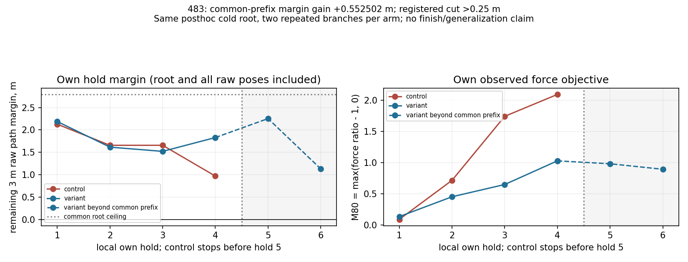

# 483 — 단일 H6 반증 비교: 국소 margin-first 게이트 통과

**공통4 own hold·0.32초의 최소 raw 경로 여유가0.967887→1.520389m로0.552502m 증가해 등록 기준>0.25m를 넘었다.** control은4회 모두 안전하게 실행한 뒤 query5의 기존 후보가 모두 부적격이어서 dispatch 전에 중단했다. variant는6회·0.48초를 안전·진행 상태로 마치고 등록 범위에서 종료했다. 각 arm의 독립 cold 반복2회와 held-first, 선택 repeat·own join을 통과했다.

판정은 `LOCAL_HYPOTHESIS_PROMOTION_GATE_PASSED`다. **사후 선정한 pre122 진단 root의 국소 모델 결과**이며 완주·원래481 전체의 인과 설명·native/warm 이전·일반화 승격이 아니다. control의 own 충돌·DNF를 막았다고 표현하지 않는다. 새 실험은 한 번만 실행했고 이후 연장·구제·후속 적분은0이다.

## 바꾼 것과 유지한 것

[482 계약](diagnostic482_contract.json)의 순위만 바꿨다. control은 eligible 후보에서 `M80 최소→active pedal 최대`, variant는 `raw 최대 경로 오차 최소→M80 최소→active pedal 최대`다. 경로 오차는 **현재 root와 모든 raw pre/post pose를 포함한 기존 canonical guard 값**으로 계산했다. endpoint 오차만 쓰거나 epsilon·가중치를 추가하지 않았다.

기존80ms/최대4raw hold, nominal/q*/활성pedal0의 완전 float32 비트 dedup, 기존 안전·진행·phase·finish guard, P4 reference/SourceC/물리/servo/steering 법칙을 유지했다. 각 query 후보 안의 steering과 활성 branch는 고정했다. 분기 후 두 arm의 상태가 달라져 이후 feedback steering 명령도 달라지므로 두 arm의 전체 조향 명령열이 같았다는 주장은 하지 않는다.

## 사전 게이트와 실행 증거

정식 무적분 static **36개**가 통과했다. 기존 pending/phase/history/codec 회귀와 새 사전식 순위·root 포함 metric·signed zero·변조·all-invalid·부분hold 판정·일반receipt RNG bytes 복원·명시적 world teardown을 포함한다. 개발 중 import/fixture 오류는 적분 전에 고쳤고, formal gate는 그 뒤 동결된 코드로 통과했다.

기존481 **4,350파일/329,731,405B**를 전수 길이/SHA/파일목록으로 확인했다. observer의 실제 cold root와 constructor 입력은 알려진 `source_world_contacts` 구조 진단만 다를 수 있음을 확인하고, observer root digest와 첫 context를 연결했다. 그 root에서 original online의121행동/484raw 전체 명령 권한·memory/RNG·ForecastLedger·tracker·시계를 **한 번** 인증했다. 각 새branch는 이 증명을 SHA로 묶은 새local root/history와 arm별 policy digest를 사용했다. 옛 recipe whitelist는 넓히지 않았다.

첫query에서 원래 cold 후보와 기존 source tolerance/discrete exact 연결을 모두 확인했고, control 선택은 저장zero, variant는 저장 자료 재순위의nominal/q*와 일치했다. 기존 명령을 강제하지 않았다. SourceC는 own query당 한 번만 호출하고 shadow는 준비된 after-memory를 사용했다. 후보를 각각 한 번 평가한 뒤 **선택만 독립 반복**, own은 기존 source join을 통과했다. 미선택 cold 예측의 반복성과 미선택 warm 반사실은 관측하지 않았다.

각 arm의 두 독립 parent는 전체 row/status/error/physical/memory/ledger signature와 관측 post signature가 정확히 같았다. 별도held-first도 같은 arm의 첫 own 전이·state·memory·ledger·RNG·post와 정확히 일치했다. 동일 root/RNG의 재현성 검증이며 독립DEV 표본수2의 일반화 증거가 아니다.

## 공통 prefix 판정과 root 상한

| local own hold | control hold 경로 여유 m | variant hold 경로 여유 m | control own M80 | variant own M80 |
|---|---:|---:|---:|---:|
| 1 | 2.127217 | 2.187508 | .090671 | .135734 |
| 2 | 1.655947 | 1.614469 | .717093 | .453456 |
| 3 | 1.655947 | 1.520389 | 1.743617 | .650182 |
| 4 | .967887 | 1.829216 | 2.094911 | 1.029649 |
| **공통4회 최소** | **.967887** | **1.520389** | — | — |
| 5 | own 미실행 | 2.252675 | — | .982683 |
| 6 | own 미실행 | 1.129031 | — | .894541 |

모든 공통hold가4raw라 실행 시간이 동일하다. 최소값 차이는 **+0.552501967m**로 등록cut>0.25m를 통과했다. 다만 hold2·3에서는 variant 여유가 더 작았으므로 매 시점의 개선으로 해석하지 않는다. variant 마지막6회 전체의 최소 여유는1.129031m로, 공통4회의1.520389m와 구분한다. 여전히 force clipping이 있으며6회 이후 안전·완주는 관측하지 않았다.

공통 root의 오차는0.207003m이고, root-inclusive 여유의 대수적 상한은 **2.792997m**다. control 공통 최소에 대한 가능한 최대 이득 상한은 **1.825110m**로0.25m보다 크다. 실제 두 arm의 공통 최소값도 이 root 상한 아래에 있어 **이번에는 공통 root가 판정 식별력을 없애지 않았다.** 이 수치는 달성한 이득이나 이후 궤적 예측이 아니다. metric/cut을 사후 변경하지 않았다.

control은 query5의 cold 예측이 모두 경로 오차4.479860/4.536379m 및road contact guard를 실패해 own5를 실행하지 않았다. control의4회 안전 prefix는 이 root에서 재현됐지만, 기존481의 warm 연속 trajectory 전체와 비트 동일하다고 주장하지 않는다. variant는6회 범위의 안전censor다. **목적함수 순위 변경이 이 제한된 모델 반증 시험에서 기존 후보집합의 임박한 소진을 피할 수 있었다**는 결과까지만 지지한다.

## 실제 비용·공간·생존 객체

| 항목 | 실제 | 승인 상한 |
|---|---:|---:|
| worlds | 86 | 110 |
| charged/positive ticks | 408/408 | 520 |
| wrapper slots | 102 | 130 |
| allocator/nominal queries | 24 | 26 |
| own holds / 선택 독립 repeats | 22 /22 | 계약 내 |
| 후보 once worlds | 58 | 계약 내 |
| 실제 생존 physical worlds 최대 | 2 | 2 |
| 동시 constructor/step 최대 | 1 | 1 |
| 종료 live/누적 명시적 해제 worlds | 0 /86 | 전부 해제 |

부모 한 개를 보존한 채 shadow 한 개를 복원하므로 실제 생존 객체는2개다. 병렬 적분은0이다. 원래source.close가 listener만 분리하는 점을 반영해, final dump 뒤 모든 body/joint를 명시적으로 제거하고 model/stream 참조를 끊었다. 해제 비용도 whole에 포함했다. 사용자 자료나 기존 파일을 삭제·이동하지 않았다.

등록/static/root121 인증과 실행·반복·cleanup·필수 readback을 합한 **실측 CPU약107.83초/wall107.10초**에, 미계측 개발 확인 비용의 **보수적20CPU/20wall초 계상**을 더해 CPU127.83초/wall127.10초다.20초는 실측값이 아니며 이 계상까지 포함해 hard480/600 안이다. allocator는CPU.315867초/wall.302287초로 호출별.25/.5 및 집계10/20초를 통과했다. constructor 구간CPU합.587761초, source step와 그 내부observer 구간CPU합.349332초다. 순수Box2D만의 분리 benchmark가 아니며 많은 인증·JSON·hash·기록 비용은 whole 값에 포함된다.

사후독립 파일/판정 감사의 별도 측정은CPU.250315초/wall.294276초, 집계 그림은CPU2.591305초/wall2.188504초다. 가벼운 후처리와 미계측 interpreter startup/관리 작업은 private 사후 비용 기록에 별도 보수 계상했다. 새 world/tick은 추가하지 않았다.

실행 직전free `/tmp`1,789,337,600B/workspace847,163,392B는 최소805,065,224/603,979,776B를 넘었다. 새raw는 **774파일/42,420,812B**, `/tmp` 단일 사본이며 별도archive와workspace raw복제는0이다. 모든 새파일을 두 번 완전히 읽어 길이/SHA/JSON/decoded state를 확인했고 마지막result/budget/progress 갱신 후 다시 읽어 최종manifest를 확정했다. 독립 사후 감사에서도 추가·누락·해시 오류0이었다.

state는44개/16,205,437B, 최대368,379B로250개/393,216B 상한을 지켰다. nonstate model25,978,139B≤58,556,416B, allocator149,354B·decision87,882B는 각각16MiB 안이었다. state+nonstate model42,183,576B는 format156,860,416B와model201,085,448B 상한을 모두 지켰다. io483은 **기존io481의 실제subclass**로 count/byte cap만 줄였고 기존 codec/schema·state/decoded SHA·inline source map을 유지했다. 원기록은 변환하지 않았다. source manifest 증가1,070B, 보수적 header estimate797,806B≤829,464B도 동결했다.

계획 SHA256: `6b917be6d7ef2c99ebcf6844decb7ddf99916e75b5dc6953e96a76a7dde5d22f`. [등록·실행 진입점](compare483.py), [정확한 두 순위와 판정](online483.py), [전체local 이력 인증](history483.py), [공개 집계](diagnostic483_result.json)를 보존했다. once marker로 중복 실행을 막는다. full input/root/RNG·코드/계획/전후manifest는 비공개 workspace에, full 명령열/raw는 비공개 `/tmp`에 있다. `/tmp` 유실 시 hash만으로 raw를 복원할 수 없으며 재실행하지 않는다.

## 다음 판단 범위와 보전

결과는 일반적인 margin-first 순위 규칙을 **별도 승인된 독립DEV 검증 후보로 남길 국소 게이트**만 통과했다. 이 단계에서는 후속DEV·더 긴 horizon·steering 확장·위치별구제·native·pixel·HOLDOUT·SEALED를 실행하지 않는다.472의 다른 상태 성공suffix나479의 단일hold 효과를 이 실험의 완주 개선으로 합치지 않는다.

보호18·공식Participants·기존backup/user 변경·main `dfb7a2de2178825ca5c5ce20bab01ba67052ba31`·기존source·전역원장 hash를 유지했다. 새actual/native/reset/HOLDOUT/SEALED는0, 최선native13.640초·연구잔액26,175·예비84,000/사용0이다. 최신 승인 종료 **2026-10-20 19:01:55 KST**, 자동 연장 없음이다. 공개물은 구현·집계·그림·보고서뿐이며 개인문서/원문/원시기록은 공개하지 않는다.
